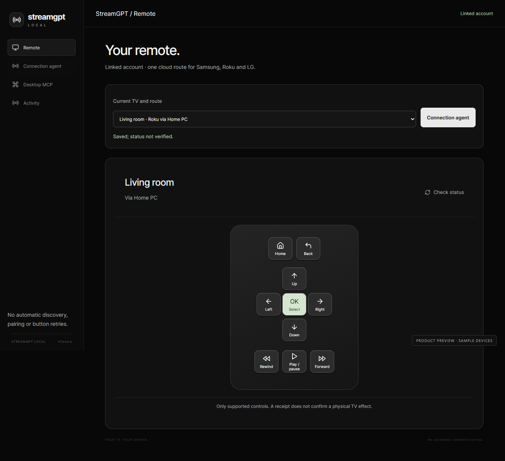

<p align="center"></p>
<h1 align="center">StreamGPT Local</h1>
<p align="center">Every screen. One place.</p>
<p align="center">A monochrome desktop remote and local MCP companion for LG webOS and Roku.<br/>Built with Rust, Tauri 2, React and TypeScript.</p>
<p align="center"><a href="https://github.com/utb2017/streamgpt-local/releases/latest">Download for Windows</a> · <a href="docs/ARCHITECTURE.md">Architecture</a> · <a href="docs/COMPATIBILITY.md">Compatibility</a> · <a href="CONTRIBUTING.md">Contribute</a></p>



## A remote that belongs in your living room

StreamGPT Local is a Rust companion for the [StreamGPT](https://streamgpt.dev) TV remote. Link your account to bring local Roku and LG TVs into the same remote as your existing Samsung connection, including authenticated ChatGPT control. The native process handles discovery, pairing, encrypted storage and commands. Tauri uses the operating system's webview instead of shipping Chromium or Node.js.

- **Find your screens.** SSDP discovery on private IPv4 interfaces, with manual IP entry when discovery is blocked.
- **Approve access.** LG pairing happens on the TV. Roku requires network control enabled in its settings.
- **Keep control local.** Pairing credentials and the command journal are encrypted using a key held by the OS credential store.
- **Watch the connection.** An explicit Connection agent panel shows candidates, pairing requests and actual activity. Choosing a TV and connecting it are separate steps; successful pairing is followed by a read-only status check.
- **Connect your AI.** The account-linked assistant reuses StreamGPT's resident agent. Buttons work without inference. Built-in stdio MCP also exposes four focused tools for desktop clients.
- **Know what happened.** Durable request IDs prevent duplicate delivery. Missing acknowledgements remain uncertain; commands are never automatically retried.

**Early preview:** discovery, enrollment and status were verified on a Roku Express running OS 16.0.4. Real remote-button effects and LG hardware compatibility remain untested. Protocol and security checks also use fixtures. The screenshot is a labeled interactive preview, not evidence of connected hardware. Roku's current ECP documentation restricts third-party platforms; availability of this source does not grant permission to distribute a commercial Roku remote. See [compatibility](docs/COMPATIBILITY.md).

## Get started

1. Download the Windows installer from [Releases](https://github.com/utb2017/streamgpt-local/releases/latest). This preview is not code-signed; Windows may show an unknown-publisher warning. Check the published SHA-256 before installing.
2. Open StreamGPT Local. Keep the computer and TV on the same home network. Ethernet and Wi-Fi both work when the router permits them to communicate.
3. Open **Connection agent**, choose **Link account**, then **Open browser**. Sign in to the same StreamGPT account you use in ChatGPT, compare the displayed code and approve this computer.
4. Back in the app, click **Find TVs**. Choose a named candidate and confirm **Connect TV**. On LG, approve the prompt on the physical TV if it appears. Roku checks network control without an LG-style approval prompt.
5. Wait for the status result, then open **Remote**. Pairing alone is not treated as verified status, and no button is sent as an automatic test.

For standalone local control, skip account linking and use the explicitly labeled local-only controller. Manual network-address entry remains under **Connection help**. Desktop AI clients can use the separate **Desktop MCP** page.

The app must remain open and the computer awake. No router port forwarding, vendor account password or paid cloud service is required for local operation. Power-on from standby, arbitrary app launching and media streaming are not included.

## Desktop MCP

The executable supports `--mcp`. The app generates the correct executable path for your installation; do not copy another user's absolute path.

| Tool | Purpose |
| --- | --- |
| `discover_tvs` | Find nearby LG/Roku devices and names without pairing or sending remote commands |
| `list_tvs` | List devices explicitly approved in the desktop app |
| `get_tv_status` | Read a paired TV's status |
| `press_tv_button` | Send one allowlisted button, with a required UUID request ID |

The MCP child process connects to an authenticated loopback endpoint owned by the running desktop app. It can discover devices, but cannot enroll, pair or forget them. Pairing keys are never returned in tool output. AI clients can use discovery to guide setup; this desktop app does not run a separate language model.

**ChatGPT on your phone:** link this helper to the same StreamGPT account connected in ChatGPT. The PC must remain awake, connected to the TV's network and running the helper; closing its window keeps it in the system tray. **Quit** in the tray stops the helper. Only outbound HTTPS/WSS is used, with expiring credentials and no router forwarding. Existing Samsung grants are preserved. Phone ChatGPT does not scan your LAN itself.

**iPhone companion:** the shared Rust/mobile source, permissions template and build instructions are prepared. Mac/Xcode signing and physical-device testing are still required; no iOS download is offered yet. See [the iOS handoff](docs/IOS.md). Do not rely on the phone app remaining a bridge while iOS suspends it.

## Development

Requirements: Node.js 22+, Rust stable and the [Tauri platform prerequisites](https://v2.tauri.app/start/prerequisites/). Windows uses the MSVC toolchain and WebView2. The Windows installer can bootstrap WebView2 if needed.

```sh
npm ci
npm run dev
```

```sh
npm run typecheck
npm run build
npm run test:ui-model
cargo test --manifest-path src-tauri/Cargo.toml
cargo fmt --manifest-path src-tauri/Cargo.toml --check
npm run dist
```

For a UI-only preview without touching a network or TV:

```sh
npm run preview
# Open http://127.0.0.1:5198/?demo=1
```

Windows installers are the initial supported distribution. macOS/Linux code paths are not release-validated. Build output, credential stores and local configuration are excluded from this repository.

## Design and engineering

- Black and neutral surfaces, a tactile directional pad, clear approval states and explicit empty states.
- A single serialized controller for UI and MCP; durable reservation precedes any button dispatch.
- Private IPv4 targets only. Discovery never follows a responder-supplied URL.
- LG certificate pinning on first approved pairing; subsequent connections must use the same certificate. Older TVs may use plaintext WebSockets on the trusted LAN.
- Deny-by-default remote webview access. The renderer has no general shell, filesystem or network capability.

See [architecture](docs/ARCHITECTURE.md), [security](SECURITY.md), and [research](docs/RESEARCH.md) for the details and tradeoffs.

## Credits

Created by **Aaron Tomlinson**. Original interface and Rust implementation. Research informed by Roku's ECP documentation, the MIT-licensed `lgtv2` protocol documentation, and existing community MCP projects. This project is not affiliated with LG, Roku, OpenAI or Samsung.

MIT licensed. Vendor names identify compatible protocols; they are not endorsements.
