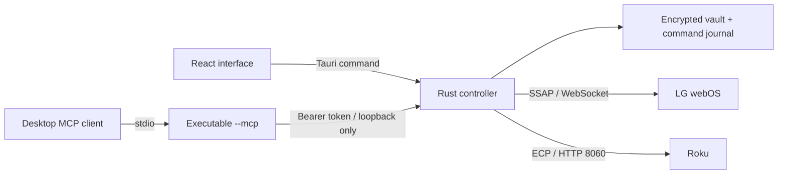

# Architecture

## Process and trust boundaries

Tauri hosts the React interface in the system webview. One explicit Rust command accepts a strictly typed operation. A capability grants this command only to the local main window. There is no arbitrary shell execution or frontend HTTP client.

The application owns a random-port HTTP listener on `127.0.0.1`, with a fresh 256-bit bearer token each launch. It rejects browser Origin headers, unexpected Host headers and incorrect tokens. The token and port are encrypted in the current user's application data. The `--mcp` subprocess retrieves them through the OS credential store; it does not receive a token in the command line or generated configuration. The local endpoint allows only snapshot, status and button requests.

## Storage

AES-256-GCM encrypts local data using a random nonce per write. The encryption key lives in the OS credential store via `keyring`. Files are written to a temporary file, synced and renamed before an operation is considered committed. An unavailable credential store is an error; plaintext fallback is not supported. LG client keys are stored inside the encrypted vault and omitted from snapshots.

All controller work uses one asynchronous mutex. Button requests require a UUID. The journal records an uncertain reservation **before** network I/O. A duplicate ID returns its existing receipt; using that ID with different command arguments is rejected. There is no automatic command retry after a lost response. The journal is bounded at 5,000 entries and stops dispatch when full rather than deleting replay protection. A journal maintenance UI is a future improvement.

## Protocols

Discovery sends SSDP searches on private IPv4 network interfaces and listens for a short bounded interval. It uses the response's source address, not an arbitrary LOCATION URL. Discovery is advisory; users choose which addresses to save and approve.

Roku uses a fixed port and allowlisted ECP paths. HTTP redirects, proxies, oversized responses and XML entity declarations are rejected. Play and pause both map to Roku's playback toggle. Volume and power support vary between Roku TVs and streaming players.

LG uses SSAP registration with an unsigned, narrowly scoped permission manifest and on-TV approval. The first approved TLS connection pins the certificate; subsequent sessions require the same certificate. Secure connection failures caused by a refused connection or timeout may fall back to port 3000 only on a first pairing. TLS validation failures do not trigger plaintext fallback. Legacy plaintext pairing must be used only on a trusted network. The input socket must point to the same TV, scheme and expected port. LG pointer-button delivery has no response acknowledgement and is reported as uncertain even after a successful send.

## Intentionally separate

The hosted StreamGPT/SmartThings app and this local controller have separate source, runtime, data and deployment. This release does not add a cloud relay. A future relay must provide user-approved device enrollment, expiring credentials, authenticated outbound connections, revocation, bounded command schemas and the same durable request journal. It must never expose the TV's port directly to the internet.
