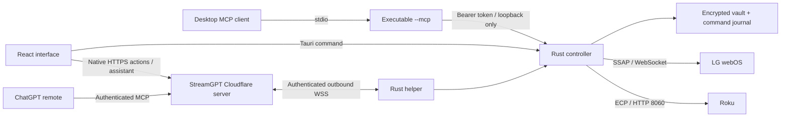

# Architecture

## Process and trust boundaries

Tauri hosts the React interface in the system webview. The local controller and cloud_command interfaces are available only to the local main window. Rust makes fixed-origin cloud requests; the renderer never receives helper tokens. There is no arbitrary shell execution or frontend HTTP client.

The application owns a random-port HTTP listener on `127.0.0.1`, with a fresh 256-bit bearer token each launch. It rejects browser Origin headers, unexpected Host headers and incorrect tokens. The token and port are encrypted in the current user's application data. The `--mcp` subprocess retrieves them through the OS credential store; it does not receive a token in the command line or generated configuration. The local endpoint allows only snapshot, discovery, status and button requests. Device enrollment, pairing and removal remain in the desktop UI.

## Storage

AES-256-GCM encrypts local data using a random nonce per write. The encryption key lives in the OS credential store via `keyring`. Files are written to a temporary file, synced and renamed before an operation is considered committed. An unavailable credential store is an error; plaintext fallback is not supported. LG client keys are stored inside the encrypted vault and omitted from snapshots.

All controller work uses one asynchronous mutex. Button requests require a UUID. The journal records an uncertain reservation **before** network I/O. A duplicate ID returns its existing receipt; using that ID with different command arguments is rejected. There is no automatic command retry after a lost response. The journal is bounded at 5,000 entries and stops dispatch when full rather than deleting replay protection. A journal maintenance UI is a future improvement.

## Protocols

Discovery sends SSDP searches on private IPv4 network interfaces and listens for a short bounded interval. It uses the response's source address, not an arbitrary LOCATION URL. Discovery is advisory; users choose which addresses to save and approve.

Opening the app or Connection agent does not start discovery. Find TVs is an explicit action; the UI presents names first, with manual address entry behind Connection help. Discovery reads identity from at most 16 Roku responders using the fixed ECP endpoint, with a 1.5-second timeout for concurrent enrichment. Device names are untrusted display data. The `discover_tvs` MCP tool lets an existing AI guide this same workflow; there is no separate model or paid inference service inside the desktop app.

Roku uses a fixed port and allowlisted ECP paths. HTTP redirects, proxies, oversized responses and XML entity declarations are rejected. Play and pause both map to Roku's playback toggle. Volume and power support vary between Roku TVs and streaming players.

LG uses SSAP registration with an unsigned, narrowly scoped permission manifest and on-TV approval. The first approved TLS connection pins the certificate; subsequent sessions require the same certificate. Secure connection failures caused by a refused connection or timeout may fall back to port 3000 only on a first pairing. TLS validation failures do not trigger plaintext fallback. Legacy plaintext pairing must be used only on a trusted network. The input socket must point to the same TV, scheme and expected port. LG pointer-button delivery has no response acknowledgement and is reported as uncertain even after a successful send.

## Account-linked helper

The hosted server and native application retain separate repositories, runtimes and storage. Version 0.2 adds an explicit account link: the native app obtains a ten-minute link code, the user signs in and approves in the system browser, and the helper claims a thirty-day credential into its encrypted vault. HTTPS and WSS target only streamgpt.dev. No router forwarding or inbound public listener is needed.

The cloud merges existing Samsung grants with each account's approved helper inventory. Native snapshot/action wrappers use existing domain validation, so deterministic buttons do not require inference. The assistant uses the existing StreamGPT resident. Discovery returns opaque candidates bound to local addresses in native memory; selecting and connecting one is a separate explicit action. Expired candidates must be rediscovered. Inventory and candidate responses are bounded at 32 entries. LAN addresses and LG keys are not sent to the cloud.

Every valid native operation records started and terminal events in a bounded in-memory activity list. Cloud domain activity is separate and account-scoped. These logs describe tool execution, not hidden model reasoning or proof of visible TV effects. Post-connect read verification is separate from saved/pair state. No test button is sent automatically.

Socket hello/inventory heartbeats run every 20 seconds; both ends expire stale connections. Reconnection never replays buttons or queues offline actions. The native durable button journal remains the final duplicate barrier. Disconnecting locally removes the credential and stops sharing; account setup can revoke the server listing. On Windows, closing the window leaves the helper in the tray; Quit disconnects it.

See [iOS preparation](IOS.md) for the shared mobile entry point, Mac build path and foreground-operation limits. The phone app does not provide an always-on background bridge while ChatGPT is foreground.

## Guided setup and discovery recovery (0.2.1)

The native app starts on Your TVs. Add a TV opens an explicit Samsung/LG/Roku flow. Account approval opens the fixed browser approval page only after a user click; the comparison code is explained and pending setup is resumed without creating another link. The current linked computer is preferred for discovery, with an explicit named choice only when required. Search state, results and confirmation remain distinct. Optional assistant chat and computer-only controls are secondary.

Windows discovery supplements multicast with directed webOS SSDP requests to a bounded set of already-known neighbors from the OS cache. Physical adapter state, interface identity, private on-link address and resolved neighbor status are checked before selecting targets. Only a valid service advertisement creates an LG candidate. The fallback performs no address-range sweep, port scan, pairing or arbitrary advertised-URL fetch. Other platforms retain multicast discovery and manual-address setup. A cache miss can still require manual setup.

The original five-second discovery window is shared by multicast and directed work, with bounded identity enrichment and a seven-second overall network budget below the cloud's ten-second deadline. Cache lookup is best-effort and cannot disable multicast. Choosing a found TV still requires explicit Connect TV.

## Permission and outage recovery (0.2.3)

Saved inventory carries optional permission, last-successful-read time and reachability evidence. The helper socket being online does not establish TV reachability or button permission. Explicit status reads remain available to refresh a blocked Roku after its settings change; background synchronization never probes TVs.

Known Roku permission denial produces a durable rejected receipt with the fixed ROKU_CONTROL_DISABLED reason. Network ambiguity remains uncertain. Hosted account operations reject conflicting work promptly while a provider operation is active, preserving serialization without retaining commands to send later. Transient inventory failures preserve selection; authoritative revocation and explicit auth failure still clear account controls. Fixed recovery codes are mapped to product guidance rather than exposing provider response bodies.
